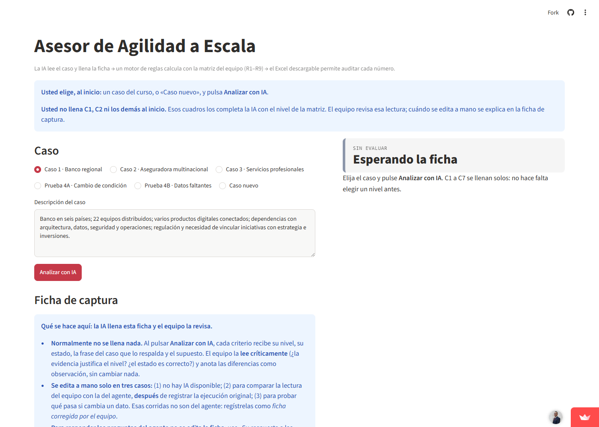

# Asesor de Agilidad a Escala (Streamlit + Gemini)

Agente que recomienda **Nexus, LeSS, SAFe o Disciplined Agile** con la matriz de decisión del equipo (PF-3872, UCR). La IA lee el caso y llena la ficha; un motor de reglas calcula con la matriz; el Excel descargable permite auditar cada número.



## Cómo probarlo

Hay tres formas, de la más sencilla a la más completa.

### 1. En línea, sin instalar nada

1. Abra **https://asesor-agilidad-pf3872.streamlit.app/**. No pide cuenta.
2. Elija un caso del curso o **Caso nuevo** y escriba o pegue la descripción de una organización.
3. Pulse **Analizar con IA**. La ficha se llena, el motor calcula y aparece la recomendación.
4. Pulse **Descargar Excel para auditar** y abra la hoja *Caso_Evaluado*: Excel recalcula con sus fórmulas y debe mostrar los mismos totales.

> La aplicación gratuita se suspende tras varios días sin visitas. Si aparece *Yes, get this app back up!*, púlselo y espere unos segundos.

### 2. En su computadora

**Requisito:** Python 3.10 o superior (https://www.python.org/downloads/). En Windows, marque *Add python.exe to PATH* al instalarlo.

**Obtener el código**, de cualquiera de estas formas:

- Con git:
  ```bash
  git clone https://github.com/jmnzcn/asesor-agilidad-escala.git
  cd asesor-agilidad-escala
  ```
- Sin git: en GitHub, **Code › Download ZIP** y descomprima; o descargue la carpeta `App_Streamlit` de la carpeta del trabajo en Google Drive. Abra una terminal dentro de esa carpeta.

**Instalar y ejecutar** (en la carpeta que contiene `app.py`):

```bash
pip install -r requirements.txt
streamlit run app.py
```

El navegador se abre en `http://localhost:8501`. Para detener la aplicación, presione `Ctrl+C` en la terminal.

**Sin clave de Gemini** la aplicación funciona en modo manual: usted elige el nivel y el estado de cada criterio y el cálculo, los gráficos y el Excel funcionan igual. **Para usar la IA**, necesita una clave propia y gratuita:

1. Créela en **https://aistudio.google.com/apikey** con una cuenta de Google.
2. Copie `.streamlit/secrets.toml.example` como `.streamlit/secrets.toml` y pegue la clave en `GEMINI_API_KEY`.
3. Vuelva a ejecutar `streamlit run app.py`.

La clave queda solo en su computadora: `secrets.toml` está excluido del repositorio y no debe compartirse.

### 3. Solo con Excel, sin el agente

Guarde una copia de `Matriz_Decision_Agilidad_Escala.xlsx` con otro nombre (Archivo › Guardar como) y, en esa copia, llene directamente la hoja **Plantilla**: el nombre y la descripción del caso, y el nivel y el estado de cada criterio. La hoja calcula los totales, las exclusiones, el desempate y la robustez con sus propias fórmulas.

No duplique la hoja dentro del libro: la comprobación de robustez (hoja Escenarios) lee la hoja Plantilla, así que en una hoja duplicada la celda de R7 no sería correcta. Para evaluar otro caso, guarde otra copia del archivo.

## Qué hace la aplicación

- **Interpretar:** Gemini lee el caso, cita la evidencia y llena la ficha de captura (nivel y estado por criterio). Si el caso no dice algo, el criterio queda faltante.
- **Calcular:** `motor_matriz.py` aplica las reglas R1 a R9 con los pesos, niveles y puntajes que lee de `Matriz_Decision_Agilidad_Escala.xlsx`. La IA no hace las cuentas.
- **Auditar:** el Excel descargable trae la matriz con la hoja *Caso_Evaluado* llena.
- **Aclarar:** si faltan datos decisivos, el resultado sale provisional y el usuario responde las preguntas del agente en «Responder al agente»; la IA relee el caso y la aplicación muestra el resultado antes y después.
- **Registrar y comparar:** cada análisis queda en la *Bitácora de ejecuciones* (descargable en CSV o JSON) y dos ejecuciones se comparan lado a lado.
- **Transparencia:** la sección «Transparencia del agente» muestra el modelo, la hora, la respuesta JSON de la IA y las instrucciones que recibió.

La aplicación no guarda fichas ni resultados de los casos: solo el texto del enunciado. Cada análisis se genera en el momento.

## Archivos

| Archivo | Qué es |
|---|---|
| `app.py` | Interfaz Streamlit y llamadas a la IA |
| `motor_matriz.py` | Motor de cálculo; lee todas las reglas del Excel |
| `graficos.py` | Gráficos del resultado |
| `Matriz_Decision_Agilidad_Escala.xlsx` | Fuente única de criterios, pesos, niveles y puntajes |
| `requirements.txt` | Dependencias de Python |
| `.streamlit/secrets.toml.example` | Plantilla para la clave de Gemini |

## Versión de las reglas

Versión 2026-11-03-r2. La robustez (R7) recorre las combinaciones de datos faltantes y reaplica exclusiones y desempates; una segunda revisión varía también los niveles inferidos. La bitácora JSON guarda la ficha completa, las exclusiones, el prompt y la respuesta de la IA, la temperatura, la versión y la huella SHA-256 de la matriz. Cuando la brecha es negativa, la recomendación fue elegida por el desempate R6. La hoja Escenarios del Excel permite revisar esa decisión sin ejecutar Python.

El 04/11/2026 se corrigió el texto de la hoja Instrucciones del Excel (evaluar cada caso en una copia del archivo, no en una hoja duplicada). Las reglas no cambiaron, pero la huella SHA-256 del archivo sí; el detalle está en `Evidencia/cambio_huella_matriz.json` de la carpeta del trabajo.

## Publicar una copia propia (opcional)

1. Cree un repositorio en GitHub con el contenido de esta carpeta. **No** suba `secrets.toml`.
2. En **https://share.streamlit.io**, *Create app › Deploy a public app from GitHub*: elija el repositorio, la rama `main` y el archivo `app.py`.
3. En **Advanced settings › Secrets**, pegue `GEMINI_API_KEY = "su-clave"`.
4. Pulse **Deploy**. En pocos minutos queda publicada con un enlace abierto, sin registro.

## Licencia

El código (`app.py`, `motor_matriz.py`, `graficos.py`) está bajo licencia [MIT](LICENSE). La matriz de decisión
(`Matriz_Decision_Agilidad_Escala.xlsx`) es el trabajo del equipo del curso PF-3872.

---

## English summary

An agent that recommends a scaled agile framework (**Nexus, LeSS, SAFe or Disciplined Agile**) for an
organization described in plain text. Built for a graduate course at the University of Costa Rica (PF-3872).

- **The LLM reads, the rules engine decides.** Gemini reads the case, quotes the evidence and fills a
  capture sheet (a level and a status for each of 7 criteria). `motor_matriz.py` then applies rules R1–R9
  with the weights, levels and scores it reads from the team's Excel matrix. The model never does the math.
- **Every number can be audited.** The app exports the matrix with the case filled in; Excel recalculates
  it with its own formulas and must show the same totals.
- **It says when it doesn't know.** Missing criteria stay missing; if they could change the answer, the
  result is marked provisional and the agent asks follow-up questions. A robustness check (R7) runs every
  combination of the missing data and reports whether the recommendation holds.
- **Runs are logged** (CSV/JSON with the prompt, the model response, the matrix's SHA-256 fingerprint)
  and two runs can be compared side by side.

Try it at **https://asesor-agilidad-pf3872.streamlit.app/** (no account needed). Without an API key the
app runs in manual mode: you fill in the sheet and the calculation, charts and Excel work the same.
Stack: Python, Streamlit, Gemini, openpyxl, Plotly.
